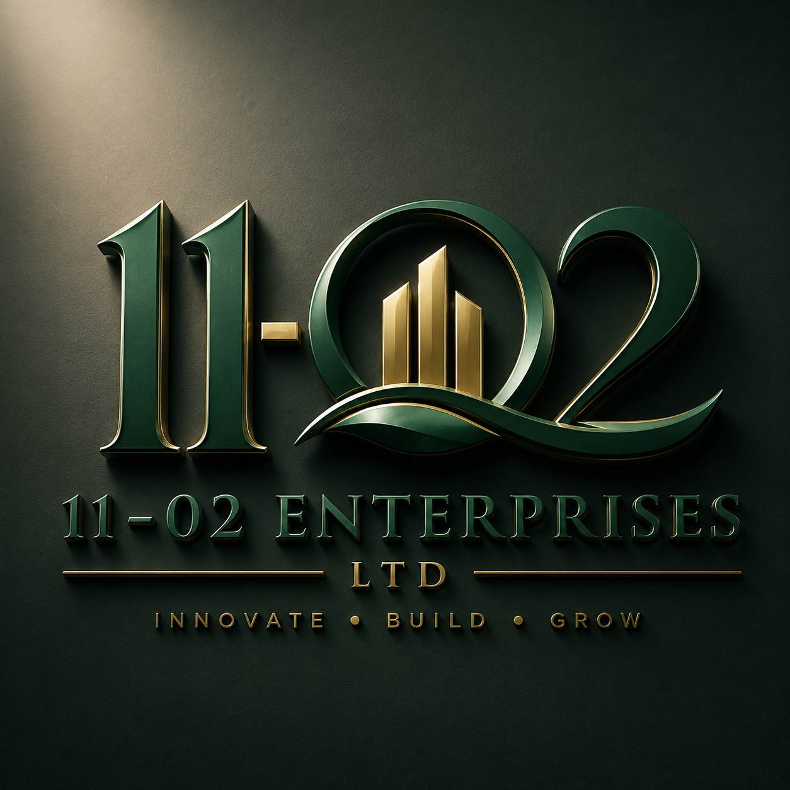

# 11-02 Enterprises Ltd — Corporate Website



**11-02 Enterprises Ltd** is a UK-based enterprise group building innovative businesses that connect people, products and opportunities.

This repository contains the source code for the official **11-02 Enterprises Ltd corporate landing page**, designed to establish the company's digital identity and introduce its growing portfolio of ventures.

---

## About 11-02 Enterprises

11-02 Enterprises Ltd is the parent company behind **11-02 Marketplace**, its flagship venture.

The company is being developed as an enterprise group with ambitions to build and operate multiple businesses across commerce, technology, food, agriculture and other high-potential sectors.

Our philosophy is simple:

> **Innovate. Build. Grow.**

The website communicates this vision while introducing the company's ecosystem, flagship marketplace and long-term growth strategy.

---

## 11-02 Marketplace

The first venture within the 11-02 ecosystem is **11-02 Marketplace** — a digital marketplace designed to connect consumers in the UK with authentic traditional and international foods.

The marketplace is built around four key areas:

### 🛍️ 11-02 Shops

Our own online retail operation selling traditional and international food products.

### 🌍 11-02 Marketplace

A multi-vendor platform where independent retailers and food businesses can onboard and sell their products to customers across the UK.

### 🌾 Farmers' Corner

A platform designed to connect farmers and producers abroad with buyers in the UK, creating more direct routes between producers and consumers.

### 🍲 Food Corner

A food and delicacy platform featuring prepared traditional meals and a rotating **Weekly Special**, giving customers access to different cultural cuisines.

---

## Website Features

The current website includes:

* Premium corporate landing page
* Responsive desktop and mobile layouts
* 11-02 Enterprises brand identity
* Deep-green and gold visual system
* Corporate hero section
* About section
* Enterprise ecosystem
* 11-02 Marketplace showcase
* Marketplace business model
* Company principles and values
* Investor/partner-oriented positioning
* Contact and partnership CTA
* Animated statistics
* Scroll-reveal animations
* Responsive mobile navigation
* 3D-inspired visual elements

---

## Design Direction

The website uses a premium, contemporary corporate aesthetic inspired by modern investment firms, venture builders and technology companies.

### Brand Colours

| Colour    | Purpose            |
| --------- | ------------------ |
| `#063B2A` | Primary deep green |
| `#0B513B` | Secondary green    |
| `#C9A45D` | Primary gold       |
| `#E0C27E` | Gold highlight     |
| `#FBFAF6` | Background         |
| `#10241C` | Primary text       |

The combination of **deep green and gold** reflects growth, stability, sophistication and long-term value creation.

---

## Technology

The current version is intentionally lightweight and does not require a build system.

### Built with

* HTML5
* CSS3
* JavaScript
* Responsive design
* CSS animations
* Intersection Observer API
* Google Fonts

The initial prototype was explored using React concepts, but the production-ready landing page uses lightweight HTML/CSS/JavaScript to make deployment straightforward.

---

## Project Structure

```text
11-02-enterprises/
│
├── index.html
├── styles.css
├── script.js
│
├── assets/
│   └── logo.png
│
└── README.md
```

### `index.html`

Contains the website structure and content.

### `styles.css`

Contains the complete visual design system, responsive layouts, animations and component styling.

### `script.js`

Handles:

* Mobile navigation
* Scroll-reveal animations
* Animated statistics
* Interactive UI behaviour

### `assets/`

Contains branding and visual assets used by the website.

---

## Running Locally

No build tools are required.

Clone the repository:

```bash
git clone https://github.com/YOUR-USERNAME/11-02-enterprises.git
```

Navigate into the project:

```bash
cd 11-02-enterprises
```

Then open:

```text
index.html
```

in a web browser.

### Alternatively

Run a local development server:

```bash
python -m http.server 8000
```

Then visit:

```text
http://localhost:8000
```

---

## Deployment

Because the website is currently a static HTML/CSS/JavaScript application, it can be deployed easily using:

* GitHub Pages
* Netlify
* Vercel
* Cloudflare Pages
* Any conventional web hosting provider

For GitHub Pages, simply enable **Pages** under the repository settings and select the appropriate branch.

---

## Roadmap

The current landing page represents the first stage of the 11-02 Enterprises digital presence.

### Phase 1 — Corporate Website

* [x] Company landing page
* [x] Corporate identity
* [x] Enterprise ecosystem
* [x] Marketplace introduction
* [x] Responsive design
* [x] Mobile navigation

### Phase 2 — Corporate Platform

* [ ] CMS integration
* [ ] Company news and announcements
* [ ] Investor section
* [ ] Partnership application
* [ ] Careers section
* [ ] Contact management
* [ ] Analytics integration

### Phase 3 — 11-02 Marketplace

* [ ] Customer accounts
* [ ] Product catalogue
* [ ] Vendor registration
* [ ] Vendor dashboards
* [ ] Shopping cart
* [ ] Checkout
* [ ] Payment integration
* [ ] Order management
* [ ] Delivery integration

### Phase 4 — 11-02 Ecosystem

* [ ] Farmers' Corner
* [ ] Food Corner
* [ ] Weekly Special
* [ ] International supplier network
* [ ] Additional 11-02 ventures

---

## Business Architecture

11-02 Enterprises is structured as the parent company of an expanding portfolio of ventures.

```text
                       11-02 ENTERPRISES LTD
                               │
              ┌────────────────┼────────────────┐
              │                │                │
              ▼                ▼                ▼
       11-02 MARKETPLACE   FUTURE VENTURE   FUTURE VENTURE
              │
      ┌───────┼────────┬────────────┐
      │       │        │            │
      ▼       ▼        ▼            ▼
    Shops  Marketplace Farmers'  Food Corner
                       Corner
```

This structure allows 11-02 Enterprises to expand into new sectors without limiting the corporate brand to a single industry.

---

## Vision

11-02 Enterprises aims to become a globally recognised enterprise group that builds market-leading businesses while creating economic opportunities and delivering meaningful value to the communities it serves.

> **One parent company. Multiple ventures. One vision.**

---

## Contributing

The repository is currently maintained as the corporate website project for 11-02 Enterprises Ltd.

Future contributions may include:

* UI/UX improvements
* Accessibility improvements
* Performance optimisation
* New website functionality
* Marketplace integrations
* New venture pages

Before submitting significant changes, please discuss the proposed change with the project maintainers.

---

## Brand

**11-02 Enterprises Ltd**

**Tagline:**
*Innovate. Build. Grow.*

**Positioning:**
*Building businesses that connect people, products and opportunities.*

---

## Licence

© 2026 **11-02 Enterprises Ltd**. All rights reserved.

Unless otherwise stated, the company's branding, logos, written content, designs and proprietary business concepts contained in this repository may not be reproduced or commercially distributed without permission.

---

## Contact

For business, partnership, investment or general enquiries:

**11-02 Enterprises Ltd**

📧 info@11-02enterprises.co.uk

---

**11-02 Enterprises Ltd — Innovate. Build. Grow.**
